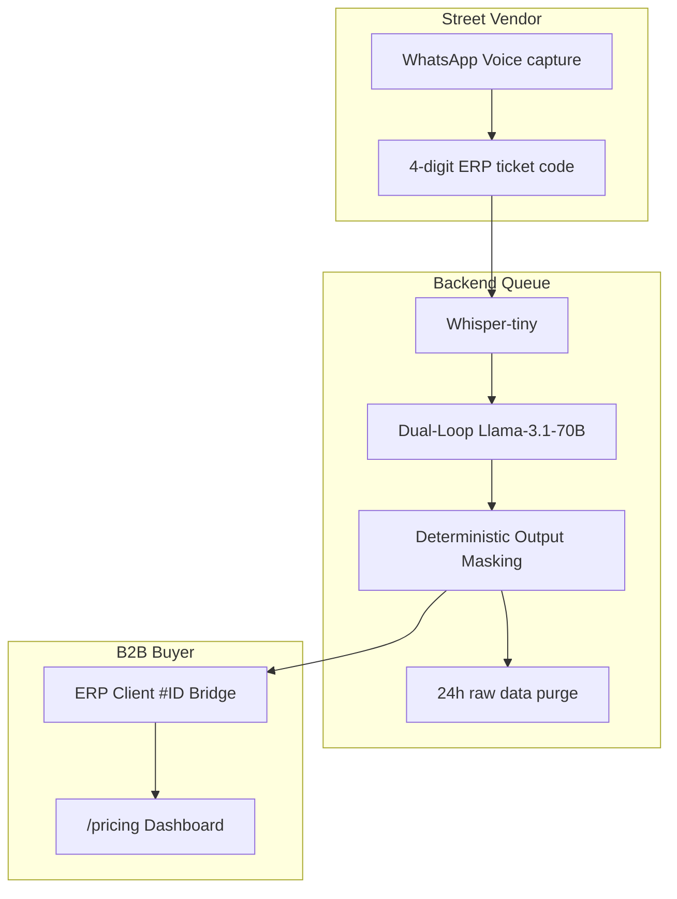
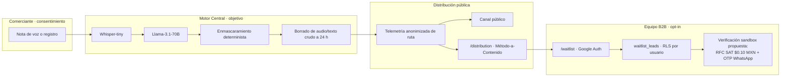

# Semana 13 — Packet Before Code

## Week 14 — Pricing: The Number That Tells the Truth

### Problem Statement & Target User

Informal merchants in Mexico, represented by Doña Mari, age 54, at Metro Tacubaya, need access to commercial credit (*fiado*) without fearing tax surveillance. FMCG distributors and micro-insurers need verified cash-flow telemetry to make safer operational and credit decisions.

### Success Definition

Before this module closes, `/pricing` is live on Vercel with an interactive Revenue Simulator and saved scenarios in browser `localStorage`, and `/about` is live with the 10:1 Value Memo. Refreshing either route must load the SPA rather than return a 404. The Week 13 tactile/acoustic voice-capture flow remains intact at `/`.

### Swimlane



### Global → Local Benchmark

- **Tala:** Its heavy APK requires SMS access, creating fear of SAT scrutiny. We avoid that invasive pattern and focus on consent-based voice and distributor records.
- **JUMO:** Its data model relies on Telcel's data monopoly. We localize the signal by anchoring it to the distributor's ERP records instead.
- **LenddoEFL:** Its 30-minute psychometric tests are a poor fit for a busy street merchant. We localize onboarding through passive analysis of a 30-second voice cadence, subject to consent and privacy safeguards.

### 3-Year Light Charter & Scope Cut

The three-year direction is a lightweight, consent-based trust and cash-flow signal connecting informal merchants to responsible B2B credit and insurance. This cut does **not** build real payment gateways or live ERP integrations. Dashboard prices, ERP bridges, model accuracy, and service levels describe the product offer, not integrations or guarantees implemented by this frontend.

### Architecture & Stack

| Area | Week 14 choice |
|---|---|
| UI | Existing Vite + React application; retain the Week 13 capture screen at `/` |
| Navigation | `react-router-dom` routes for `/`, `/pricing`, and `/about` |
| Deployment routing | Vercel SPA rewrite to `/index.html` |
| Revenue calculations | Client-side deterministic calculations using bounded numeric inputs |
| Scenario storage | Browser `localStorage`; simulated presets and user-created assumptions only |
| Privacy | No real personal data in presets; no external database or API secrets |

### Mechanical Test Plan

1. Build with `npm run build`.
2. Verify route navigation and retain the existing capture page without modifying its recording handlers or controls.
3. Check all simulator slider bounds, default month-six totals, gross margin, and the zero-volume/zero-revenue case.
4. Save, load, compare, and delete scenarios; validate names and ensure presets are visibly labeled `SIMULATED DATA`.
5. Inspect responsive layout at a 360px viewport and verify the Vercel SPA rewrite.

### Mechanical Test Log & Correction

- `npm run build` passed after implementation and after the boundary fix.
- The default model produced 10,200 profiles, $249,000 MXN revenue, $29,325 MXN COGS, $219,675 MXN gross profit, and 88.22% gross margin. The zero-revenue case returns a defined 0% margin; negative and above-maximum values are rejected.
- A 360px browser check reported a 345px document client width and 345px scroll width, so the page had no horizontal overflow. Route navigation, direct refresh of `/about`, and the root capture control were verified.
- A browser save/reload/delete check verified scenario persistence and deletion. The comparison table updates with the current assumptions.
- **Bug found and fixed:** numeric-only scenario names could retain identifying numbers, and one invalid old record could block the entire scenario manager after validation tightened. Custom names now accept only generic allowlisted terms and month numbers 1–12; invalid stored records are removed and reported, while valid scenarios remain usable. Invalid numeric fields and names containing personal identifiers are rejected.
- Vercel rewrite JSON validation and `git diff --check` passed.

## Diagrama de flujo de trabajo

El diagrama describe el recorrido desde la captura hasta la tarjeta de confianza. IndexedDB conserva fragmentos recuperables; una interrupción del navegador no puede mantener activa la grabación, por lo que la recuperación retoma únicamente lo que alcanzó a persistirse. El almacenamiento del navegador está sujeto a cuota y políticas del dispositivo.

```mermaid
flowchart LR
    subgraph UI["UI del Vendedor — React / Client"]
        direction TB
        Start["Vendedor inicia captura"]
        Haptic["Un pulso táctil corto<br/>navigator.vibrate"]
        Capture["Captura de micrófono<br/>MediaRecorder / OGG-OPUS"]
        Indicator["Indicador tenue en pantalla<br/>verde: buffer activo<br/>amarillo: pausa / pendiente"]
        VAD{"¿Silencio por más de 4 s?"}
        Pause["Pausar silenciosamente la captura<br/>sin enviar petición final"]
        Manual{"¿Cierre manual?"}
        DoubleHaptic["Doble pulso táctil<br/>navigator.vibrate"]
        Resume["Reanudar captura cuando<br/>el vendedor esté listo"]
        Assemble["Unificar fragmentos disponibles<br/>y validar tamaño"]
        ShowCard["Mostrar la tarjeta de confianza técnica"]
        Start --> Haptic --> Capture
        Capture --> Indicator
        Capture --> VAD
        VAD -- "No" --> Capture
        VAD -- "Sí" --> Pause
        Pause --> Indicator
        Pause --> Manual
        Manual -- "No; cliente requiere atención" --> Resume
        Resume --> Capture
        Manual -- "Sí" --> DoubleHaptic --> Assemble
    end

    subgraph IDB["Disco Local — IndexedDB"]
        direction TB
        Persist["Guardar fragmento en transacción atómica<br/>status: pending_upload"]
        Durable["Persistencia administrada por el navegador<br/>cuota y permiso sujetos al dispositivo"]
        Scan["Al iniciar la app, buscar fragmentos<br/>pending_upload y recuperables"]
        Queue["Reconstruir cola de sincronización<br/>sin descartar fragmentos huérfanos"]
        Persist --> Durable
        Scan --> Queue
    end

    subgraph EDGE["Cloudflare Edge — Workers AI"]
        direction TB
        Receive["Recibir POST con audio unificado<br/>validar tipo y tamaño del payload"]
        Preprocess["Preprocesar audio y reducir ruido<br/>antes de la inferencia"]
        Whisper["Workers AI: Whisper-tiny<br/>transcripción del audio"]
        Clean["Normalizar y preparar texto<br/>sin asumir traducción semántica automática"]
        Receive --> Preprocess --> Whisper --> Clean
    end

    subgraph LLM["Backend LLM B2B"]
        direction TB
        Ingest["Ingerir JSON estructurado<br/>con texto validado"]
        Validate["Validar esquema, longitud<br/>y contenido antes de consultar el modelo"]
        Trust["Emitir Technical Trust Card"]
        Ingest --> Validate --> Trust
    end

    Capture -- "Fragmentos de audio" --> Persist
    Pause -- "Resguardar lo capturado" --> Persist
    Durable -- "Fragmentos disponibles" --> Assemble
    Assemble -- "POST autenticado; payload acotado" --> Receive
    Clean -- "JSON validado; secretos solo en servidor" --> Ingest
    Trust --> ShowCard

    AndroidKill["Falla: Android mata la pestaña<br/>por presión de memoria durante la grabación"]
    BrowserRecovery["En el siguiente arranque:<br/>inicializar IndexedDB y escanear fragmentos"]
    LostTail["La porción aún no persistida puede perderse;<br/>no se promete recuperar audio en RAM"]
    AndroidKill -. "cierre abrupto" .-> BrowserRecovery
    AndroidKill -. "límite de recuperación" .-> LostTail
    BrowserRecovery --> Scan
    Queue -- "Sincronizar cuando haya red<br/>y consentimiento/condiciones válidas" --> Receive
```



### Comportamiento ante interrupciones

- **Pausa de más de cuatro segundos:** el VAD pausa silenciosamente el stream, conserva el fragmento ya capturado en IndexedDB con estado `pending_upload` y no envía una petición final. La captura puede reanudarse cuando el vendedor esté listo.
- **Pestaña terminada por Android:** al volver a abrir la aplicación, la inicialización examina IndexedDB y recupera los fragmentos persistidos para reconstruir la cola de sincronización. El audio que seguía únicamente en memoria al momento del cierre no es recuperable; el flujo debe tolerar fragmentos incompletos y no presentarlos como una sesión completa.

## Prompt de generación de imagen para mockup UI/UX

Mockup editorial fotorrealista de una aplicación móvil de asistencia para una comerciante de comida en un puesto callejero de la Ciudad de México, en una escena cotidiana y digna, no publicitaria. Un teléfono Android de gama baja de aproximadamente 2019 está colocado sobre un mostrador gastado de madera o metal rústico, junto a un comal caliente, varios tlacoyos recién hechos y vasos de jugo; al fondo, un mercado urbano concurrido y ligeramente desenfocado, con luz natural de calle y ambiente auténtico. La pantalla del teléfono muestra una interfaz React móvil extremadamente simple, legible y de alto contraste, con un botón central grande pensado para tocarse con facilidad y una superficie visual despejada. No mostrar números, cuenta regresiva, cronómetro, gráficos complejos ni párrafos. Incluir solo etiquetas breves e intuitivas en español, por ejemplo “Escuchando” o “En pausa”. Representar el estado del búfer mediante un pequeño indicador luminoso LED simulado en pantalla, muy tenue y sin destellos agresivos: verde suave mientras el audio se captura y amarillo cálido cuando el sistema está en pausa o resguardando un fragmento; el color nunca debe ser la única señal de estado. El diseño transmite calma, respeto y confianza, evita alarmas y presión de tiempo, y se entiende de un vistazo con ruido y distracciones alrededor. Composición cercana a nivel del mostrador, teléfono claramente visible y con la interfaz enfocada, proporciones realistas, reflejos moderados que no oculten la pantalla, tipografía sencilla y grande, paleta cálida y discreta. No incluir marcas, logotipos, datos personales, transcripciones legibles ni texto decorativo inventado.
# Semana 15 — Distribution: Your Method Feeds Your Audience

## 1. Problema y usuario exacto

**Comprador B2B:** Jefe de Crédito y Cobranza de una distribuidora regional mexicana de consumo masivo, Tier-2, con 15–60 rutas y operación en la Central de Abasto o Vallejo. Su problema a validar es la pérdida estimada de **~$820,800 MXN/año** por impagos de fiado de los viernes y verificaciones manuales de **$150 MXN**. Son supuestos de trabajo, no resultados medidos ni promesas; en el material de campaña se identifican como **DATOS SIMULADOS / COHORTE DE PRUEBA (n=60)**.

**Comerciante:** Doña Mari, 54 años, vendedora de comida frente al Metro Tacubaya. Necesita un “Cierre del Día” sencillo que le ayude a reconocer fugas de efectivo sin temor a compartir su RFC, sin lenguaje de vigilancia y sin presentarla como una fuente de datos disponible para terceros.

## 2. Definición de éxito

**Before the module closes, X works:** existe una ruta `/distribution` con simulador de Input → Método → Contenido Útil y tres formatos demostrativos; `/waitlist` ofrece acceso con Google, validación en cliente y captura protegida por RLS; `/about` publica métricas de distribución honestas, distinguiendo ceros reales de datos simulados, e incluye un enlace al canal social público cuando se proporcione su URL. Las rutas pueden funcionar como demostración local, pero Auth y persistencia requieren configurar Supabase.

## 3. Wireframes ASCII

### `/distribution` — escritorio y móvil

```text
┌──────────────────────────────────────────────────────────────┐
│ Validador del Comercio      Captura | Precios | Distribución │
├──────────────────────────────────────────────────────────────┤
│ DISTRIBUCIÓN · Tu método alimenta a tu audiencia             │
│ De una señal operativa a una pieza útil, sin exponer personas│
│ [DATOS SIMULADOS / COHORTE DE PRUEBA (n=60)]                 │
│                                                              │
│ ┌───────────────┐    ┌────────────────┐   ┌────────────────┐ │
│ │ 1 · INPUT     │ -> │ 2 · MÉTODO     │-> │ 3 · CONTENIDO  │ │
│ │ Nota/registro │    │ Motor Validador│   │ Tarjeta B2B    │ │
│ │ [Elegir caso] │    │ [Procesar]     │   │ [Ver resultado]│ │
│ └───────────────┘    └────────────────┘   └────────────────┘ │
│                                                              │
│ ┌ Tarjeta de telemetría ┐ ┌ Auditoría antes/después ┐         │
│ └ Calculadora de fugas por fiado (controles acotados) ┘       │
│ [Solicitar acceso B2B → /waitlist]                            │
└──────────────────────────────────────────────────────────────┘

360 px: navegación envuelta; tarjetas apiladas; controles a 100%;
sin anchuras mínimas que provoquen scroll horizontal.
```

### `/waitlist`

```text
┌────────────────────────────────────────────┐
│ Distribución | Captura | Precios | Acceso  │
├────────────────────────────────────────────┤
│ Acceso anticipado para equipos B2B         │
│ 1. Continuar con Google (Supabase OAuth)    │
│ 2. Completa después del inicio de sesión   │
│ Empresa [____________________________]     │
│ RFC      [____________] (12/13 caracteres) │
│ Rutas    [___] (1–500)                     │
│ WhatsApp [__________] (10 dígitos)         │
│ [Enviar solicitud]                         │
│ Solo tu usuario puede consultar su fila.   │
│ [Canal público — URL pendiente]             │
│ Confirmación / error accesible y explícito │
└────────────────────────────────────────────┘
```

## 4. Flujo de datos (swimlane)

El diagrama es una arquitectura objetivo; no afirma que los modelos, borrado automático, enmascaramiento, SAT, OTP o telemetría ya estén conectados. El sandbox de verificación de RFC es una propuesta de **$0.10 MXN** y no ejecuta consultas fiscales.



## 5. Línea de referencia (benchmark line)

| Referencia | Aprendizaje a contrastar | Diferencia que proponemos |
|---|---|---|
| Tiendatek / Kueski | Herramientas y financiamiento para comercio local | Lenguaje y flujo adaptados a cobranza de distribuidores mexicanos; las diferencias son hipótesis, no un análisis competitivo cuantificado. |
| Gong / Airtable PLG | Método repetible y distribución de conocimiento/producto | Convertir un método operativo en contenido legible para el comprador sin publicar datos identificables. |
| JUMO | Distribución de servicios financieros en mercados emergentes | Localización al contexto mexicano y consentimiento entendible; no activar regulación CNBV SIC ni inducir miedo al SAT. No es asesoría legal ni una exención regulatoria. |

## 6. Visión a 3 años

En tres años, el Validador del Comercio ayudará a distribuidores regionales a entender mejor el riesgo operativo de sus rutas sin convertir la informalidad en motivo de exclusión. Cada comerciante conservará control y claridad sobre lo que comparte, mientras cada señal se transforma en una explicación útil y limitada para una decisión de negocio. La expansión dependerá de consentimiento verificable, seguridad, medición honesta y revisión regulatoria antes de ofrecer decisiones financieras.

## 7. Recorte de alcance (scope cut)

- No se procesa voz en vivo ni se despliegan Whisper/Llama, backend central, enmascaramiento o borrado temporizado.
- No se envían telemetría, RFC, OTP de WhatsApp, ni solicitudes reales a SAT; no hay integración ERP, WhatsApp, pasarela de pago ni CNBV/SIC.
- No se publican datos reales, resultados de cohortes reales, métricas de conversión no instrumentadas ni estimaciones presentadas como hechos.
- Esta semana no se implementan cuentas, edición ni borrado de solicitudes; el formulario requiere Google Auth y la tabla solo permite a cada usuario insertar y leer su propia fila.
- El canal social no se inventa: el URL exacto está pendiente de confirmación.

## 8. Playbook de marca y campaña

### Audiencia, posicionamiento y evidencia

- **Audiencia primaria:** jefaturas B2B de Crédito y Cobranza en distribuidoras Tier-2 de 15–60 rutas, Central de Abasto/Vallejo.
- **Audiencia de respeto y prueba de comprensión:** comerciantes como Doña Mari; no son un recurso publicitario ni una fuente de datos sin consentimiento.
- **Posicionamiento:** método claro para convertir una señal operativa limitada en una decisión de ruta entendible y contenido útil para equipos B2B.
- **Evidencia disponible:** prototipo y supuestos ilustrativos. No hay cohortes reales documentadas. Toda pieza que use valores de ejemplo llevará la etiqueta literal **DATOS SIMULADOS / COHORTE DE PRUEBA (n=60)**; n=60 no significa participantes reales.
- **Promesa que NO hacemos:** garantizar recuperación de deuda, aprobación de crédito, exactitud de modelos, ahorro anual, cumplimiento regulatorio, consulta a SAT ni protección derivada de una señal automatizada.

### Tres reglas de voz

1. **Concreta, no grandilocuente:** nombra una tarea de ruta, no “revolucionamos el crédito”.
2. **Consentida, no vigilante:** explica qué dato se usa, por qué y qué no se hace con él.
3. **Honesta con la evidencia:** etiqueta simulaciones y separa prototipo de integración real.

**Antes:** “Predice quién no te va a pagar y recupera $820,800 al año.”

**Después:** “Prueba cómo una señal de liquidación puede ordenar una revisión de ruta. Ejemplo simulado; no predice impagos ni garantiza ahorros.”

### Sistema visual

Se conserva el sistema existente: tipografía de sistema (`system-ui`, Segoe UI y equivalentes); verde oscuro `#294a32`/`#345b3e`, verde de apoyo `#527b35`, fondo cálido `#f5f2e9`, tarjetas `#fffdf8`, texto `#242a24` y acento dorado `#d3a43e`. Tarjetas redondeadas, contraste alto, foco visible dorado y controles táctiles; sin tipografías externas ni estética de alarma.

### Seis conceptos en tres series

| Serie recurrente | Concepto | Estado y formato | Contenido |
|---|---|---|---|
| **La ruta en claro** | 1. Pulso de ruta | **Terminada · tarjeta de telemetría** | Estado agregado, indicador simulado, sin nombres ni coordenadas; etiqueta obligatoria de cohorte. |
| **La ruta en claro** | 2. Un viernes, dos cierres | Bocetada · guion de video corto | Contrastar registro incompleto vs. registro ordenado sin atribuir conducta a una persona real. |
| **La cuenta entendible** | 3. Liquidación antes/después | **Terminada · auditoría de una página** | Mismo caso ilustrativo en dos columnas; supuestos y límites a la vista. |
| **La cuenta entendible** | 4. Glosario de fiado | Bocetada · carrusel de 3 láminas | Definiciones claras de saldo, evidencia y revisión; sin juicio moral. |
| **Método que enseña** | 5. Calculadora de fugas | **Terminada · herramienta interactiva** | Controles locales y acotados para explorar escenarios; no estima riesgo individual. |
| **Método que enseña** | 6. De señal a decisión | Bocetada · diagrama/carousel | Ejemplo de cómo una entrada simulada produce un resumen útil y anonimizado. |

Los tres formatos terminados son artefactos demostrativos para `/distribution`, no publicaciones ya distribuidas. Las tres piezas bocetadas no se mostrarán como contenido publicado.

### Ejemplo `input → método → contenido útil`

**Input:** registro ficticio: “ruta 04, cierre esperado $8,000, cierre contado $7,600”; no hay nombres ni RFC.

**Método:** calcular una diferencia de $400, marcarla como dato simulado, mostrar que requiere revisión humana y no inferir fraude ni impago.

**Contenido útil:** tarjeta: “Revisa $400 de diferencia antes de cerrar la ruta. DATOS SIMULADOS / COHORTE DE PRUEBA (n=60). No es una conclusión sobre una persona.”

## 9. Arquitectura, stack y plan de pruebas

| Capa | Decisión / límite |
|---|---|
| Interfaz | React 19 + Vite; seguir componentes, estilos y paleta actuales. |
| Navegación | `react-router-dom`; conservar `/`, `/pricing`, `/about` y agregar `/distribution`, `/waitlist`. |
| Autenticación | `@supabase/supabase-js` con Google OAuth; solo la URL y anon key públicas del proyecto en variables `VITE_`. |
| Captura | `waitlist_leads` en Supabase con `auth.uid()` como propietario y RLS para `SELECT`/`INSERT` propios. Sin políticas públicas ni credenciales de servicio en frontend. |
| Validación | Empresa normalizada y limitada; RFC mexicano de persona física/moral (`^[A-Z&Ñ]{3,4}\\d{6}[A-Z0-9]{3}$`); rutas enteras 1–500; WhatsApp de 10 dígitos. Limpiar caracteres de control y espacios; renderizar siempre como texto, nunca HTML. |
| Datos de campaña | Constantes de demostración locales con etiqueta explícita; calculadora acotada en cliente. |
| Despliegue | Vercel SPA rewrite existente a `/index.html`; variables configuradas fuera del repositorio. |

**Pase mecánico**

1. `npm run build`; revisar rutas, consola y errores de React.
2. Confirmar que no existe `.env.local` versionado, secretos ni valores de ejemplo con aspecto de credencial; `.env.local` debe estar ignorado.
3. Probar formularios: vacío, exceso de longitud, caracteres de control, RFC inválido, rutas 0/501/decimal, WhatsApp con 9/11 dígitos, envío sin sesión, error de Supabase y confirmación autenticada.
4. Verificar RLS: sin sesión no hay lectura/inserción; usuario A no ve ni inserta en nombre de B; usuario autenticado solo accede a su propia fila.
5. Revisar `/`, `/pricing`, `/about`, `/distribution` y `/waitlist` a 360 px y escritorio; navegación, refresh directo, foco y ausencia de desbordamiento horizontal.
6. Confirmar que cada métrica de ejemplo visible lleva la etiqueta de cohorte, y que las métricas de `/about` dicen 0 cuando no existe telemetría real.

**Persona test — Doña Mari:** con una pantalla de 360 px y lenguaje cotidiano, encontrar el cierre del día, distinguir claramente una simulación, saber qué se enviaría y qué no, ubicar cómo salir sin compartir RFC, y completar la tarea sin depender solo del color ni de texto pequeño. La prueba no debe pedir datos reales.
